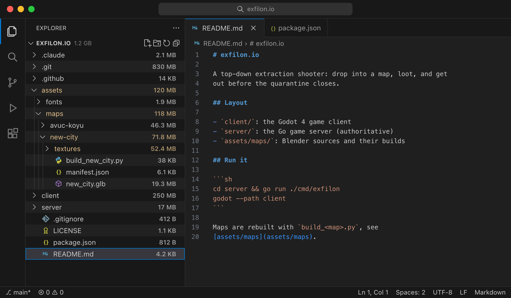
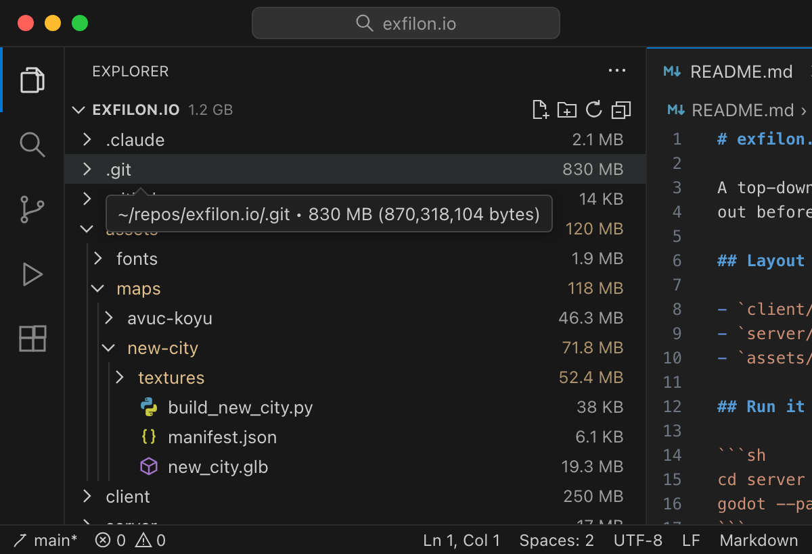
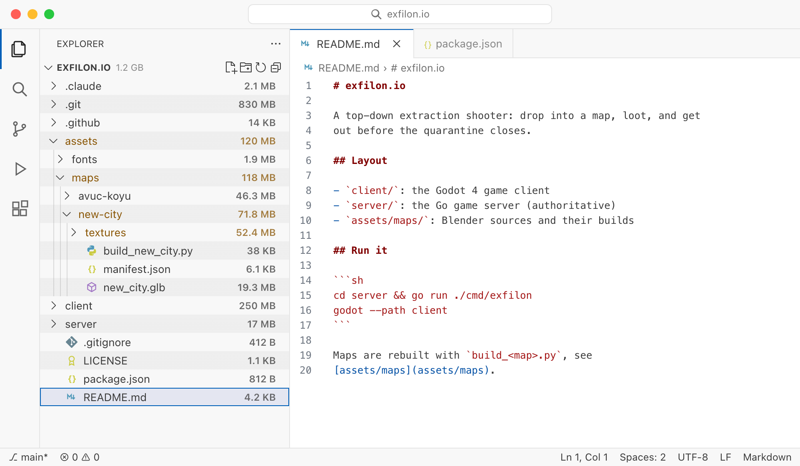

# Explorer Sizes

**See what takes up the space, right where your files are.** Explorer Sizes puts every file's and folder's size at the
right of its row in VS Code's own Explorer, and the open folder's total beside its name at the top.

## Features

- **A size on every row.** Files and folders alike (`830 MB`, `4.2 KB`, `812 B`), a folder's being everything under
  it, worked out in the background and kept up to date as files change.
- **The exact count of bytes** in each row's tooltip.
- **The open folder's total** beside its name at the top: after the window's title (`exfilon 1.2 GB`), or in the
  command center when that is on, and in the Explorer's heading when that is shown. Should the patch be missing, it shows in the status bar instead
  (click it to work every size out again).
- **Git colours kept.** A folder with changed files under it shows its size in git's colour instead of the usual dot.
- No new view and no settings: it is the Explorer you already use.

## It patches VS Code

VS Code lets an extension put only a character or two beside a name in the Explorer, so `830 MB` would be turned
away. To show it anyway, Explorer Sizes changes VS Code's own installed files. Please read this before installing.

- **What changes:** the extension host's check on a badge's length is taken out; a folder with git changes under it
  keeps its own badge (its size) instead of git's dot; the title bar and the Explorer's heading show the folder's
  total (and the status bar's copy of it is hidden). Nothing else.
- **Originals are kept** beside each changed file as `<name>.orig`.
- **Checksums are updated.** VS Code keeps checksums of its files in `product.json`; they are brought up to date, so
  VS Code does not report its installation as corrupt.
- **One restart.** After patching, VS Code asks to be quit and opened again; the sizes appear after that.
- **Updates.** A VS Code update puts the original files back. The extension patches the new version on its next start
  and asks for one more restart. If an update has changed the code it patches, it says so instead of guessing.
- **Windows:** VS Code must be able to write to its own folder. The usual user install can; a system-wide install
  under Program Files cannot, and the extension tells you.

Nothing is sent anywhere: sizes come from reading your workspace's files on your own machine.

## Commands

- **Explorer Sizes: Refresh**: works every size out again.
- **Explorer Sizes: Undo VS Code Patch**: puts VS Code's original files back. Uninstall the extension as well, or it
  patches them again on the next start; then quit and reopen VS Code.

## Notes

- Folders VS Code's file watcher skips (`files.watcherExclude`, e.g. `node_modules` or `.git/objects` by default)
  still show their size, but it does not follow changes inside them by itself: run **Explorer Sizes: Refresh**.
- With several folders open, the heading shows their sum.

## License

MIT
